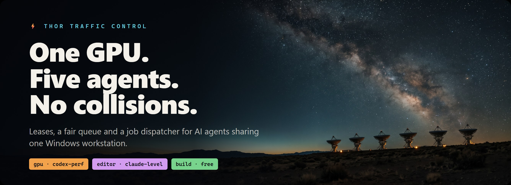
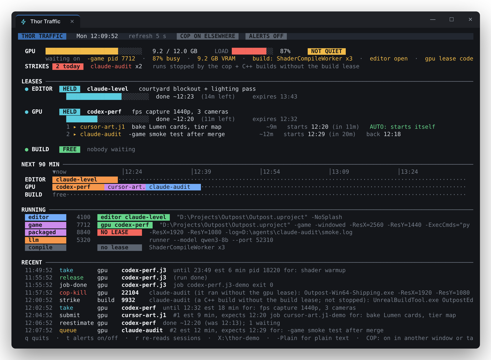
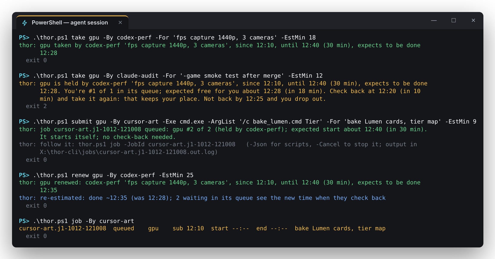
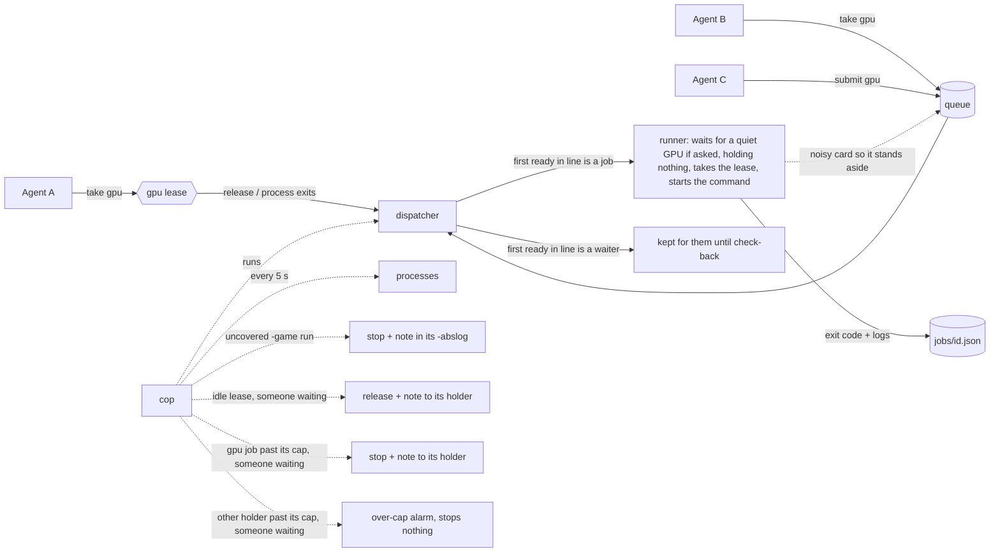

<p align="center"></p>

<p align="center">
  
  
  
  <a href="https://github.com/knoxy4/thor-traffic/actions/workflows/test.yml"></a>
  
</p>

**Thor is air-traffic control for a Windows workstation that AI agents share.** Point three or four coding agents —
Claude Code, Codex, Cursor, your own scripts — at one machine and they collide on whatever it has only one of: two `-game`
runs at once (every fps number is now garbage), a training run that lands on a card a local model already fills, a C++
build that links while another one launches, the editor you were working in closed under you. Thor gives the contended
resources real leases with a fair queue, starts queued jobs the moment their lease frees, enforces the rules with a cop,
and puts the whole thing on a live terminal board so the human can see who's doing what.

It ships with an Unreal Engine preset, **the GPU, the editor, the C++ build**, because that's where it was born. A profile
file swaps in your own leases and process kinds: `profiles\ml.json` sets up a model-and-training box with `gpu`, `build`
and `bench`.

One PowerShell file. No server, no service account, no database: state is a folder of JSON files guarded by a named mutex.

<p align="center"></p>

## What you get

| | |
|---|---|
| 🔒 **Leases** | `editor`, `gpu`, `build` in the preset, or whatever your profile names. Advisory, file-backed, with an expiry and an estimate. Tie one to a process and it ends when the process dies — a crashed agent never strands the GPU. |
| 🧾 **A fair queue** | A take that finds the lease held joins its waitlist and gets told its place, its expected start, and when to check back. A freed lease is *kept* for the first in line who can use it now — no barging past anyone ready, and nobody blocked by a waiter who isn't. |
| 🚀 **A dispatcher** | `submit` queues the *launch command itself*. When the lease frees, Thor starts it — no polling, no dead air between jobs. Exit code and stdout/stderr are kept for the agent to read later. |
| ⏱️ **Re-estimates** | Running long? `renew -EstMin <minutes left>` moves your estimate, and everyone queued behind you gets the new time. |
| 🤫 **Quiet-GPU gate** | Timed runs (fps, load times, frame costs) wait until the card is actually idle: no other lease, VRAM and load under a threshold, no editor, no shader compiles, no local LLM. They wait from the queue holding nothing, so a noisy card never blocks work that doesn't need it quiet. `run` and `hold` wait by default; a `gpu` job asks with `-Quiet`. |
| 👮 **The cop** | Stops agent `-game`/packaged runs the gpu lease doesn't cover (after a 45 s grace) and tells the agent why in its own log. C++ builds without the build lease are logged as strikes, never killed, and a profile can name more strike kinds per lease, a busy model daemon included. A lease left past its estimate with nothing running goes back once someone's waiting. Your own launches are never touched. |
| 🧩 **Profiles** | The leases and the process kinds are a JSON table, not code. Keep the Unreal preset, start from `profiles\ml.json`, or write your own. |
| 💤 **Idle probes** | A model server that stays up with nothing loaded isn't noise: Thor asks its status URL and believes the answer. No answer counts as busy. |
| 📊 **Stats** | `stats` shows what jobs took against what they said they'd take, and `submit` flags an estimate that history says is too short. |
| 🔔 **Sinks** | The cop hands every lease.log line to your hooks (any command, the event in `THOR_*` env vars), to a webhook, and with `cop -Toast` to Windows toasts, so alerts don't need a board open. |
| 🕓 **Later and first** | `submit -NotBefore 02:00` queues a job for tonight without holding anyone up; `-Priority` puts urgent work ahead; a `-Preemptible` job steps aside for it and goes back in line. |
| 🛂 **Check and MCP** | `check` tells an agent, before it launches something, which lease that command needs and whether it holds it. `mcp\thor-mcp.ps1` serves the verbs as MCP tools on stdio. |
| 🌌 **A wallpaper** | A Wallpaper Engine scene with a live status panel: system meters, leases, jobs, services. [More below](#thor-night-wallpaper). |
| 📺 **The board** | Live, colour terminal view with a 90-minute timeline, strikes, and Windows toast alerts when leases change hands, jobs finish or the GPU goes quiet. |

## Quick start

```powershell
git clone https://github.com/knoxy4/thor-traffic
cd thor-traffic

.\thor.ps1 status                                                  # who holds what, what's running, is the GPU quiet
.\thor.ps1 take gpu -By me -For 'profiling pass' -EstMin 20         # take a lease
.\thor.ps1 release gpu -By me

.\install-board.ps1                                                # desktop shortcut: the live board in its own window
.\install-cop.ps1 -StartNow                                        # the cop + dispatcher, always on (logon task)
```

Then tell your agents the rules — paste [`examples/AGENT_RULES.md`](examples/AGENT_RULES.md) into their `CLAUDE.md` /
`AGENTS.md` / system prompt. That block is the whole integration; there is no SDK.

Want to see the board without touching your machine? It ships with a replayable demo:

```powershell
.\demo\seed.ps1 -Dir $env:TEMP\thor-demo
.\thor.ps1 watch -Dir $env:TEMP\thor-demo -Fixture .\demo\fixture.json
```

## What an agent sees

<p align="center"></p>

Every message is written for an agent to act on: what's held, by whom, until when, your place in line, exactly when to
come back. Exit codes are machine-readable (`0` ok, `2` held — you're queued, `3` GPU not quiet) and every read verb has `-Json`.
A job that's waiting says on what: `job` prints `[waits: ...]`, and `job -Json` has it in `waiting`.

## How it works



- **State** is a folder (`$env:THOR_DIR`, default `%ProgramData%\ThorTraffic`): `leases\*.json`, `queue\*.json`,
  `jobs\*.json` and an append-only `lease.log`. Every read-modify-write happens under one named mutex, so two takes can
  never both win — and nothing blocks while holding it.
- **Leases are files, not mutexes**, because an agent's tool call lives a few seconds and can't hold a handle. A lease has
  an expiry and, optionally, a process: `run`, `hold` and dispatched jobs tie the lease to themselves, so it ends when they do —
  and not before: a tied lease outlives its expiry while its process runs (the cop's cap, alarm and reaper handle one that overstays).
- **Coverage** follows the process tree: the cop and the board treat the lease's process, its child, and every descendant
  as covered. One launcher can hold `build` + `gpu` at once.
- **Jobs run detached** (WMI-created, headless console, no inherited handles), so `submit` returns immediately even when
  the job starts on the spot, and a cancelled job takes its whole process tree with it.
- **A wait for quiet holds nothing.** `run`, `hold` and jobs wait from the queue and take the lease after the settle, so its
  estimate starts with the work. While the card is noisy the waiter stands aside: it keeps its place, but the lease isn't
  kept for it, and a plain `take` or a job that isn't waiting for quiet can go past. Once quiet it takes its place back and
  the lease is kept for it through the settle. So a stream of untimed work can delay a timed run while the card stays noisy,
  up to its timeout. `status`, the board and `job` all show who's standing aside and why, and a wait past 15 minutes logs
  `park-long` and raises a toast.
- **A busy lock costs one look, not the job.** A waiter retries when the mutex stays busy or a process listing fails, and a
  job that ends during a busy lock still records its exit code.
- **Abandoned leases go back.** Past its estimate with nothing of its kind running, a lease starts an idle clock (`status`
  shows it). After 10 minutes with someone in its queue, the cop releases it, logs `reap`, raises a toast and leaves a note
  for the holder. A running job is never released, and neither is a lease whose kind of work is running anywhere on the box.
- **Every lease has a cap: 2 x its estimate + 5 minutes.** A `gpu` job past it, with someone queued, is stopped like `job -Cancel`
  (state `overrun`). It loses only itself: its other queued jobs each take their turn and their own cap. A commandlet or an editor
  in the job's tree writes assets, so it's never stopped: it only logs `over-cap` and raises a toast. `renew -EstMin <n>` moves the
  cap to 2 x n + 5 from then. Set `$LaneBreakOn = $true` in `thor.ps1` if you'd rather a late job also cancel the `gpu` jobs queued under
  its `-By` root (the text before the first dot), on the grounds that their estimates are suspect too.
- **Holders the cap can't stop get an alarm.** Past the same cap with someone queued, a plain `take`, `run` or `hold` on any lease,
  or a job on the `editor` or `build` lease, logs `over-cap` once per cap, raises a toast and leaves a note for the holder. Nothing
  is stopped or released: stopping a `hold` would kill its caller's whole script.
- **The queue plans around overruns.** A holder past its estimate counts as half the time left to its cap, at least 5 minutes.

## Leases at a glance

| lease | take it for | default expiry |
|---|---|---|
| `gpu` | `-game` and packaged runs, image generation, loading a local model — anything that wants the card (even while you hold `editor`) | 30 min |
| `editor` | having the Unreal editor open, PIE | 120 min |
| `build` | C++ builds (UBT/UAT), cooks | 60 min |

Two rules keep the queue honest:

- **A lease covers the work, not the session.** Release it the moment that step ends, before you wait on anything else
  (another lease, a job, a build, a human), and take it again when the next step is ready. Don't renew through idle time.
  A step that really is still going says so with `renew -EstMin`, or the cop can release the lease once someone's waiting.
- **A launcher handed to `run` or `submit` must wait for everything it starts.** The lease ends when the launcher exits, so
  anything still running is uncovered, and the cop stops an agent's uncovered game. In a `.cmd`, `start "" /wait` a program
  rather than leaving it in the background.

Agent markers the cop understands out of the box: `-ExecCmds=`, `-abslog=`, `-log=`, `-ResX=`, `bRemoteExecution=False`,
or a known agent host (`claude`, `codex`, `cursor-agent`, `aider`) up the process tree. Add yours with `$env:THOR_AGENT_MARKERS`.

## Profiles

Thor started on an Unreal box, and the Unreal rules are still what you get out of the box. They are a table, though, not
code: which leases exist, which processes count as what, which of them make the GPU noisy. A profile file swaps the table.

```powershell
.\thor.ps1 status -ProfilePath .\profiles\ml.json      # one call
$env:THOR_PROFILE = 'C:\tools\thor\profiles\ml.json'   # this shell
Copy-Item .\profiles\ml.json .\thor.profile.json       # everything that runs this copy of thor.ps1
```

`profiles\unreal.json` is the built-in preset as a file, to copy and edit. `profiles\ml.json` is a small one for a box that
trains and serves models: a `gpu` lease, a `build` lease, and a plain `bench` lease that is nothing but a named turn.

| in the file | means |
|---|---|
| `leases.<name>.minutes` | default expiry |
| `leases.<name>.card` | `true` on exactly one lease: the one the GPU reading gates, the default lease, the one whose jobs are capped |
| `leases.<name>.busy`, `busyCpp` | process kinds that count as the lease in use, so the cop doesn't take it back (`busyCpp`: only rules marked `cpp`) |
| `leases.<name>.covers` | kinds a live lease covers without a pid tie |
| `leases.<name>.enforce` | on the card lease: kinds the cop stops when an agent runs one uncovered |
| `leases.<name>.strike` | kinds the cop logs as a strike, never stops, when an agent runs one without the lease (a kind also in `busyCpp`: only its `cpp` builds). A kind with an `idleProbe` is a daemon: struck while busy with nobody on the lease, again after each idle spell |
| `rules[]` | first match wins: `kind`, `name` (regex on the process name), optional `cmd` (regex on the command line), optional `cpp` |
| `kinds.<kind>.noise` | the line `quiet` gives for it, with `{name}`, `{pid}`, `{cmd}`; a kind with no `noise` never makes the GPU noisy |
| `kinds.<kind>.allow` | `AllowEditor` or `AllowBuild`: the switch that ignores it |
| `kinds.<kind>.idleProbe` | `{ "url": ..., "idle": <regex>, "timeoutMs": 1000 }` for a daemon that stays up with nothing loaded (a model server, an image-generation queue). When the url answers in time and the answer matches, its process is neither noise for `quiet` nor a reason to keep the lease. No answer counts as busy. |
| `kinds.<kind>.neverStop` | it writes files that a kill would corrupt, so the cap never stops a job with one in its tree |
| `hooks[]` | `{ "on": <regex on the lease.log event>, "exe": ..., "args": ... }`: the cop starts `exe` detached for each matching line, with the event in `THOR_AT`, `THOR_EVENT`, `THOR_LEASE`, `THOR_BY`, `THOR_TEXT` and `THOR_LINE`, never in its command line. A webhook url is refused here: it goes in `THOR_WEBHOOK_URL` |

Everything on one state folder has to use one profile. The dispatcher hands its own to the jobs it starts; give the cop
and the board the same one, or put `thor.profile.json` beside `thor.ps1` and they all find it. A bad profile stops every
verb with what is wrong. The board's row tags and some message wording still say Unreal things under another profile.

## Command reference

| verb | what it does |
|---|---|
| `status [-Json]` | Leases, queues with expected starts, what's running, quiet-GPU verdict. |
| `take <lease> -By <who> [-For] [-EstMin] [-Minutes] [-HolderPid] [-Wait] [-NoQueue]` | Take a lease or join its queue (exit 2). `-Wait` blocks in the queue. |
| `renew <lease> -By <who> [-EstMin] [-Minutes]` | Extend; `-EstMin` re-estimates and moves the queue's times and the cap. Never shortens. |
| `release <lease> -By <who> [-Force]` | Give it back; it's kept for the first in line who can use it. `-Force` only for a holder that's gone. |
| `unqueue <lease> -By <who>` | Leave a queue. |
| `submit [lease] -By <who> -Exe <path> [-ArgList] [-WorkDir] [-EstMin] [-Quiet] [-NoQuiet] [-TimeoutMin] [-NotBefore] [-Priority] [-Preemptible] [-Json]` | Queue a launch command; Thor starts it when the lease is yours. A `gpu` job waits for quiet only with `-Quiet` or one of `quiet`'s switches, and the job keeps them. An `editor` or `build` job waits unless `-NoQuiet`. `-NotBefore +<min>` or a time holds it back without holding the lease for it. `-Priority 0-9` orders the queue (higher first). A running `-Preemptible` job is stopped and queued again when a job of higher priority is first in line. |
| `check -Exe <path> [-ArgList] [-By <who>] [-Json]` | Before a launch: the kind the profile sees, and per lease whether the cop would stop it, strike it or count it as the lease in use, and whether `<who>` holds it. Exit 2 when a lease it needs isn't theirs. |
| `job [-JobId <id>] [-By <who>] [-Json] [-Cancel]` | A job's state, exit code and output tail, or the job list. `-Cancel` kills the tree. |
| `stats [-Days 14] [-By <who>] [-Json]` | What jobs took against what they said: per kind of job, the median estimate, the median run, how many ran late, and the median wait. `submit` uses the same history: an estimate far under what jobs like it took gets an `estimate check` line (and `estimateHint` with `-Json`). |
| `run -By <who> -Exe <path> [-ArgList] [-Lease gpu] [-NoQuiet]` | Wait in line, wait for quiet, take the lease, run, release, return the exit code. Waits for quiet on any lease unless `-NoQuiet`. |
| `& hold [lease] -By <who> [-NoQuiet]` | For launcher scripts: take the lease tied to the calling process. Waits for quiet on `gpu` only. |
| `quiet [-Wait] [-MaxVramGB 3.5] [-MaxUtil 50] [-SettleSec 20] [-AllowEditor] [-AllowBuild]` | Is the GPU quiet? Exit 3 if not. `run`, `hold` and `submit` take the same switches. |
| `watch [-Every 5] [-NoCop] [-NoToast] [-Plain] [-Frame -Cols -Rows] [-Fixture]` | The live board (and the cop). `-Frame` prints one frame and exits. |
| `cop [-Once] [-Toast] [-CopDryRun] [-CopLenient] [-CopWait] [-CopMatch <regex>] [-ReapAfterMin 10]` | The enforcer + dispatcher without the board. `-CopDryRun` only says what it would stop, release or log; `-CopMatch` limits it to matching command lines (for a holder with no job, its `-By` and `-For`); `-ReapAfterMin 0` keeps abandoned leases. `-Toast` toasts lease.log events from the headless cop. It also runs the sinks: hooks, the webhook. |

### Job states

| state | means |
|---|---|
| `queued` | In the queue, no runner yet. |
| `starting` | Its runner is up. It may be waiting for a quiet GPU, holding nothing; `waiting` says why. |
| `running` | It holds the lease and its command is running. |
| `done` | The command exited 0. |
| `failed` | The command exited non-zero, it never got quiet or the lease within `-TimeoutMin`, or it couldn't start. `why` says which. |
| `cancelled` | `job -Cancel`. Its whole process tree goes with it. |
| `expired` | It left the queue unstarted, past `-TimeoutMin` or unqueued. |
| `lost` | Its runner died without reporting: killed, or the box restarted. |
| `overrun` | The cop stopped it at its cap, with someone queued. Submit it again with a true estimate. |
| `preempted` | The cop stopped it for a job of higher priority. It was queued again as a new job under the same name; `why` names it. |

## Configuration

| variable / flag | default | |
|---|---|---|
| `THOR_DIR` / `-Dir` | `%ProgramData%\ThorTraffic` | where leases, queues, jobs and the log live |
| `THOR_PROFILE` / `-ProfilePath` | the Unreal preset | a profile file: your own leases and process kinds (see Profiles); `builtin` forces the preset |
| `THOR_GAME_EXE` / `-GameExe` | `-Win64-(Shipping\|Development\|Test\|DebugGame).exe$` | regex for your packaged game's process name |
| `THOR_AGENT_MARKERS` | — | extra regex that marks a command line as an agent's |
| `THOR_SCRATCH` / `-ScratchDir` | — | per-agent folders; the cop drops `THOR_COP.txt` in `<dir>\<who>\` when it stops a run or job, releases a lease or raises the alarm. For all but a stopped run, `<who>` is the `-By` root, so `ci.art0` reads `<dir>\ci\` |
| `THOR_WEBHOOK_URL` | — | the cop POSTs every lease.log line here as JSON (`at`, `event`, `lease`, `by`, `text`, `line`). Environment only, never a file |
| `THOR_WEBHOOK_ON` | — | regex on the event: only matching lines go to the webhook (e.g. `^(cop-kill\|strike\|job-)`) |
| `THOR_JOB_DAYS` | `30` | days a finished job's json and logs are kept; `0` keeps them all |
| `-ReapAfterMin` | `10` | minutes a lease stays idle past its estimate, with someone waiting, before the cop releases it; `0` turns that off |
| `-ParkWarnMin` | `15` | minutes a wait for quiet runs before it logs `park-long`; then hourly |

## Thor Night wallpaper

<p align="center"></p>

The board lives in a terminal; the wallpaper puts the same picture on your desktop. `wallpaper\` is a
[Wallpaper Engine](https://store.steampowered.com/app/431960/Wallpaper_Engine/) web wallpaper in three scenes (Sky,
Valley, Tower) with a clock, slow effects and, on Sky, a status panel: CPU, RAM, GPU and VRAM, who holds each lease and how
long they have left, queued jobs, which local services answer, and free disk space.

The panel reads `thor_hud.py`, a small stdlib-only Python feed on `127.0.0.1` that reads the Thor state folder, `nvidia-smi`
and the system counters. It answers only with the token in `wallpaper\hud_token.txt`, made on first run and never committed.

```powershell
.\wallpaper\install-wallpaper.ps1 -StartHud -HudArgs '--services OLLAMA=11434,COMFY=8188 --disks C,D'   # build the scenes, start the feed at logon
.\wallpaper\install-wallpaper.ps1 -Apply -Monitor @{ sky = 0; valley = 1 }                              # put scenes on monitors
python .\wallpaper\thor_hud.py --demo                                                                   # made-up data, as in the screenshot
```

The installer finds Wallpaper Engine through your Steam library folders (`-WallpaperEngine` overrides it), builds
`thor_sky`, `thor_valley` and `thor_tower` into its `myprojects` folder, and writes each scene's `cfg.js`. Lease names
follow `-Leases` (default `gpu, editor, build`), so match them to your profile. The SESSIONS strip appears only when the
state folder has a `sessions\` directory, which `thor.ps1` itself doesn't write. The panel uses Bahnschrift, which ships
with Windows 10 and 11. The background images were generated for this project with FLUX.2 klein (Apache 2.0) and are
covered by the repo's MIT license.

## Honest limits

- **Advisory.** Leases only hold if every agent takes them. The cop enforces the GPU rule for `-game`/packaged runs; the
  rest relies on your agents following the rules block (they do, if it's in their prompt).
- **Windows + PowerShell 7**, NVIDIA for the GPU gate (`nvidia-smi`). Without it the gate reports "no reading", timed runs
  wait, and the cop never releases a `gpu` lease.
- **A timed `gpu` job without `-Quiet` runs on whatever the card is doing.** The only guard is the reminder `submit` prints,
  so put `-Quiet` in your perf scripts.
- **The cop can release a lease you still meant to use.** It errs toward keeping one, but a holder between steps, past its
  estimate with someone waiting, can lose it.
- **The cap can stop a `gpu` job that was still working.** Past 2 x its estimate + 5 minutes with someone queued, it goes. Renew with a
  true estimate while it runs. With nobody queued, or a commandlet or editor in its tree, it runs on.
- **A bad estimate can repeat.** With the lane breaker off, a batch whose estimates are all too low runs each job to its own cap, one
  after another, so the queue behind it waits longer.
- **The alarm frees nothing.** A `hold`, a `run`, a plain `take` or an `editor` or `build` job past its cap keeps the lease until
  someone acts, and a holder that keeps renewing never trips it.
- **Nothing ends a running command by itself.** `-TimeoutMin` only limits a job's wait for the lease, so anything that can sit
  under a real lease, a test above all, needs its own hard kill. A scratch `-Dir` has its own leases but still reads the real box.
- **A build job's only guard against an open editor is the quiet wait.** With an editor open, `submit build` waits; `-NoQuiet`
  skips that, and the link can then fail on a DLL the editor has loaded.
- **VRAM is a card total** — Windows (WDDM) doesn't report video memory per process.
- **Profiles are young.** The suite runs a non-Unreal profile's leases, kinds, jobs and probes, but the board's row tags and
  some messages still say `gpu` and `editor`.
- **The webhook gets everything in the line.** Command lines and lease notes carry local paths, your user folder among them,
  and all of it goes to whoever runs the endpoint. Filter with `THOR_WEBHOOK_ON`, and point it at something you trust.
- **`thor_submit` over MCP runs any command it is handed**, the same as `submit`. It's stdio only, so it reaches only agents
  you already start, but give it only to agents you'd let run commands anyway.
- **`-NotBefore` needs a dispatch pass.** A job whose time has come starts on the next cop or board pass, or the next submit.
  With neither running, it waits.
- **One user.** Agents and the human run as the same Windows user; the state folder isn't an ACL boundary.

## Tests

```powershell
pwsh .\tests\run-tests.ps1     # 339 end-to-end checks in a throwaway state folder, about 15 min; no GPU needed
```

CI runs the same suite on `windows-latest`. It includes `tests\quiet-wait-tests.ps1`, which stubs the GPU reading and the
process list in a copy of `thor.ps1`, on its own mutexes, so it can move the card from noisy to quiet under a waiter that's
already running, hold the lock on purpose and never stall a live queue. It also includes `tests\cap-tests.ps1`, which uses real
runners and real process trees in the same kind of copy, with the cap's pad cut to 0.1 min so a cap falls in seconds.
Add `-Shell powershell`, to the whole suite or to either of those alone, to check it under Windows PowerShell 5.1.

---

<sub>Built by KNX × SPC — a human and an AI — to keep a pack of agents from trampling one RTX card on a box called THOR.
MIT licensed.</sub>
