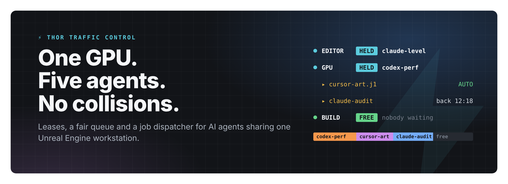
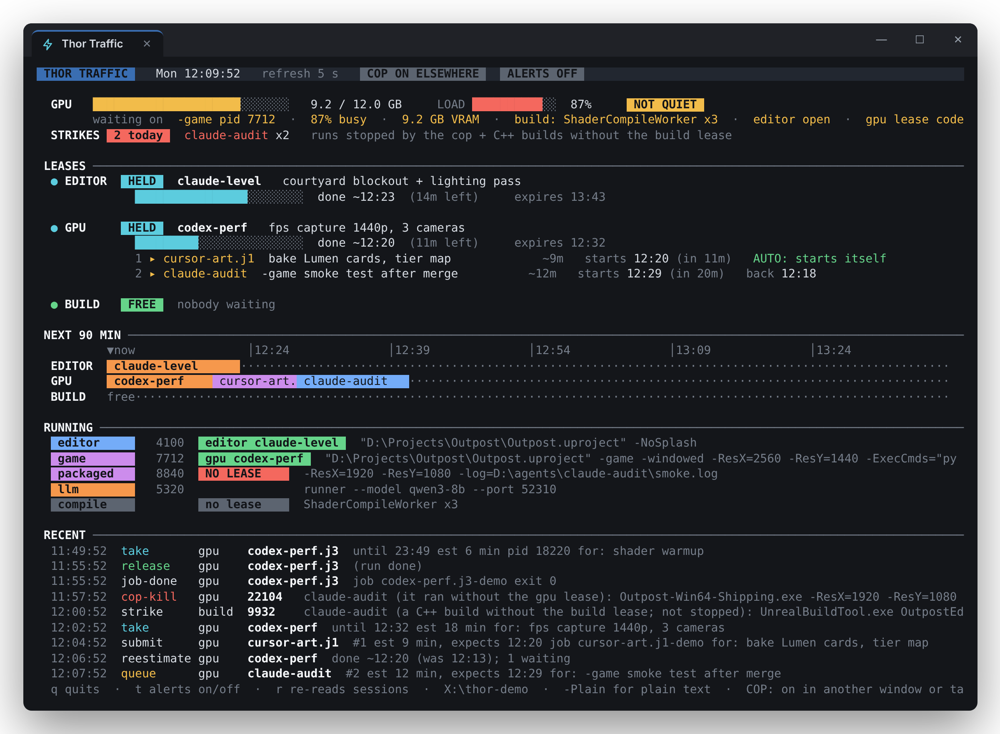
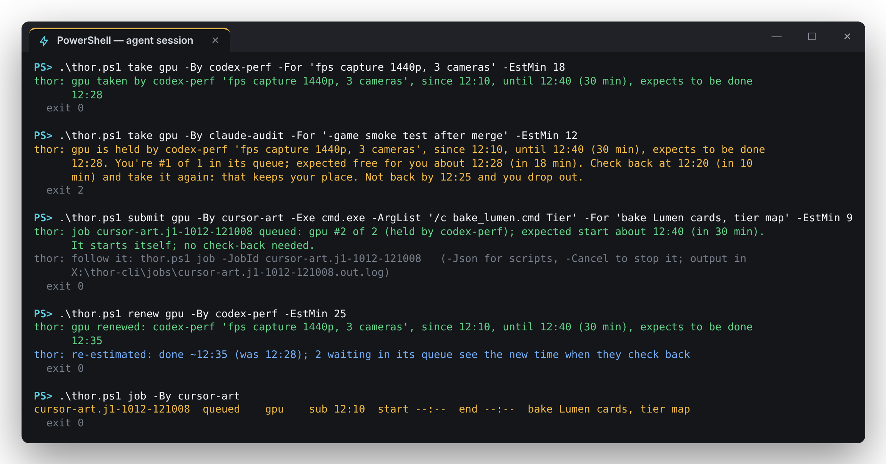
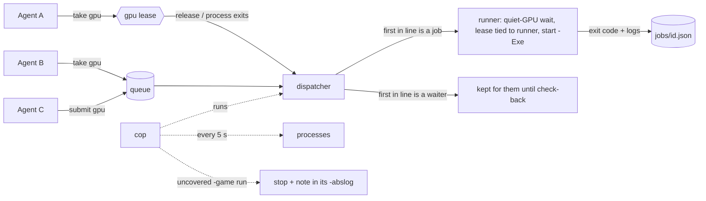

<p align="center"></p>

<p align="center">
  
  
  
  <a href="https://github.com/knoxy4/thor-traffic/actions/workflows/test.yml"></a>
  
</p>

**Thor is air-traffic control for a game-dev workstation that AI agents share.** Point three or four coding agents —
Claude Code, Codex, Cursor, your own scripts — at one Unreal Engine project on one machine and they will happily launch
two `-game` runs at once (every fps number is now garbage), close the editor you were working in, and kick off a C++
build while another one is linking. Thor gives the contended resources — **the GPU, the editor, the C++ build** — real
leases with a fair queue, starts queued jobs the moment their lease frees, enforces the rules with a cop, and puts the
whole thing on a live terminal board so the human can see who's doing what.

One PowerShell file. No server, no service account, no database: state is a folder of JSON files guarded by a named mutex.

<p align="center"></p>

## What you get

| | |
|---|---|
| 🔒 **Leases** | `editor`, `gpu`, `build`. Advisory, file-backed, with an expiry and an estimate. Tie one to a process and it ends when the process dies — a crashed agent never strands the GPU. |
| 🧾 **A fair queue** | A take that finds the lease held joins its waitlist and gets told its place, its expected start, and when to check back. A freed lease is *kept* for the first in line — no barging. |
| 🚀 **A dispatcher** | `submit` queues the *launch command itself*. When the lease frees, Thor starts it — no polling, no dead air between jobs. Exit code and stdout/stderr are kept for the agent to read later. |
| ⏱️ **Re-estimates** | Running long? `renew -EstMin <minutes left>` moves your estimate, and everyone queued behind you gets the new time. |
| 🤫 **Quiet-GPU gate** | Timed runs (fps, load times, frame costs) wait until the card is actually idle: no other lease, VRAM and load under a threshold, no editor, no shader compiles, no local LLM. |
| 👮 **The cop** | Stops agent `-game`/packaged runs the gpu lease doesn't cover (after a 45 s grace) and tells the agent why in its own log. C++ builds without the build lease are logged as strikes, never killed. Your own launches are never touched. |
| 📺 **The board** | Live, colour terminal view with a 90-minute timeline, strikes, and Windows toast alerts when leases change hands, jobs finish or the GPU goes quiet. |

## Quick start

```powershell
git clone https://github.com/knoxy4/thor-traffic
cd thor-traffic

.\thor.ps1 status                                                  # who holds what, what's running, is the GPU quiet
.\thor.ps1 take gpu -By me -For 'profiling pass' -EstMin 20         # take a lease
.\thor.ps1 release gpu -By me

.\install-board.ps1                                                # desktop shortcut: the live board in its own window
.\install-cop.ps1 -StartNow                                        # the cop + dispatcher, always on (logon task)
```

Then tell your agents the rules — paste [`examples/AGENT_RULES.md`](examples/AGENT_RULES.md) into their `CLAUDE.md` /
`AGENTS.md` / system prompt. That block is the whole integration; there is no SDK.

Want to see the board without touching your machine? It ships with a replayable demo:

```powershell
.\demo\seed.ps1 -Dir $env:TEMP\thor-demo
.\thor.ps1 watch -Dir $env:TEMP\thor-demo -Fixture .\demo\fixture.json
```

## What an agent sees

<p align="center"></p>

Every message is written for an agent to act on: what's held, by whom, until when, your place in line, exactly when to
come back. Exit codes are machine-readable (`0` ok, `2` held — you're queued, `3` GPU not quiet) and every read verb has `-Json`.

## How it works



- **State** is a folder (`$env:THOR_DIR`, default `%ProgramData%\ThorTraffic`): `leases\*.json`, `queue\*.json`,
  `jobs\*.json` and an append-only `lease.log`. Every read-modify-write happens under one named mutex, so two takes can
  never both win — and nothing blocks while holding it.
- **Leases are files, not mutexes**, because an agent's tool call lives a few seconds and can't hold a handle. A lease has
  an expiry and, optionally, a process: `run`, `hold` and dispatched jobs tie the lease to themselves, so it ends when they do.
- **Coverage** follows the process tree: the cop and the board treat the lease's process, its child, and every descendant
  as covered. One launcher can hold `build` + `gpu` at once.
- **Jobs run detached** (WMI-created, headless console, no inherited handles), so `submit` returns immediately even when
  the job starts on the spot, and a cancelled job takes its whole process tree with it.

## Leases at a glance

| lease | take it for | default expiry |
|---|---|---|
| `gpu` | `-game` and packaged runs, image generation, loading a local model — anything that wants the card (even while you hold `editor`) | 30 min |
| `editor` | having the Unreal editor open, PIE | 120 min |
| `build` | C++ builds (UBT/UAT), cooks | 60 min |

Agent markers the cop understands out of the box: `-ExecCmds=`, `-abslog=`, `-log=`, `-ResX=`, `bRemoteExecution=False`,
or a known agent host (`claude`, `codex`, `cursor-agent`, `aider`) up the process tree. Add yours with `$env:THOR_AGENT_MARKERS`.

## Command reference

| verb | what it does |
|---|---|
| `status [-Json]` | Leases, queues with expected starts, what's running, quiet-GPU verdict. |
| `take <lease> -By <who> [-For] [-EstMin] [-Minutes] [-HolderPid] [-Wait] [-NoQueue]` | Take a lease or join its queue (exit 2). `-Wait` blocks in the queue. |
| `renew <lease> -By <who> [-EstMin] [-Minutes]` | Extend; `-EstMin` re-estimates and moves the queue's times. Never shortens. |
| `release <lease> -By <who> [-Force]` | Give it back; it's kept for the first in line. `-Force` only for a holder that's gone. |
| `unqueue <lease> -By <who>` | Leave a queue. |
| `submit [lease] -By <who> -Exe <path> [-ArgList] [-WorkDir] [-EstMin] [-NoQuiet] [-TimeoutMin] [-Json]` | Queue a launch command; Thor starts it when the lease is yours. |
| `job [-JobId <id>] [-By <who>] [-Json] [-Cancel]` | A job's state, exit code and output tail, or the job list. `-Cancel` kills the tree. |
| `run -By <who> -Exe <path> [-ArgList] [-Lease gpu] [-NoQuiet]` | Wait in line, wait for quiet, run, release, return the exit code. |
| `& hold [lease] -By <who>` | For launcher scripts: take the lease tied to the calling process. |
| `quiet [-Wait] [-MaxVramGB 3.5] [-MaxUtil 50] [-SettleSec 20]` | Is the GPU quiet? Exit 3 if not. |
| `watch [-Every 5] [-NoCop] [-NoToast] [-Plain] [-Frame -Cols -Rows] [-Fixture]` | The live board (and the cop). `-Frame` prints one frame and exits. |
| `cop [-Once] [-CopDryRun] [-CopLenient] [-CopWait]` | The enforcer + dispatcher without the board. |

## Configuration

| variable / flag | default | |
|---|---|---|
| `THOR_DIR` / `-Dir` | `%ProgramData%\ThorTraffic` | where leases, queues, jobs and the log live |
| `THOR_GAME_EXE` / `-GameExe` | `-Win64-(Shipping\|Development\|Test\|DebugGame).exe$` | regex for your packaged game's process name |
| `THOR_AGENT_MARKERS` | — | extra regex that marks a command line as an agent's |
| `THOR_SCRATCH` / `-ScratchDir` | — | per-agent folders; the cop drops `THOR_COP.txt` in `<dir>\<who>\` when it stops a run |

## Honest limits

- **Advisory.** Leases only hold if every agent takes them. The cop enforces the GPU rule for `-game`/packaged runs; the
  rest relies on your agents following the rules block (they do, if it's in their prompt).
- **Windows + PowerShell 7**, NVIDIA for the GPU gate (`nvidia-smi`). Without it the gate reports "no reading" and timed runs wait.
- **VRAM is a card total** — Windows (WDDM) doesn't report video memory per process.
- **One user.** Agents and the human run as the same Windows user; the state folder isn't an ACL boundary.

## Tests

```powershell
pwsh .\tests\run-tests.ps1     # 26 end-to-end checks in a throwaway state folder; no GPU needed
```

CI runs the same suite on `windows-latest`.

---

<sub>Built by KNX × SPC — a human and an AI — to keep a pack of agents from trampling one RTX card on a box called THOR.
MIT licensed.</sub>
